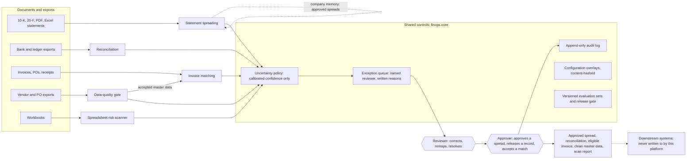

# Finance Operations Platform (statement-spreader)

A local, $0 platform that does the keying and ticking finance teams do by hand, checks it, and sends only what it is
unsure of to a person. Built as the foundation for a real deployment at a company whose clients include a large share
of the biggest US companies: trustworthy before fast, every number traceable to where it was printed, every change
measured, and adaptable to a company's own data through configuration. **A tested prototype, not a production
system**: one machine, sign-in tested only against a local test identity provider, measured on public filings and
synthetic data only. Progress toward production: [PRODUCTION_READINESS.md](PRODUCTION_READINESS.md).

## Who uses it, what it replaces, what stays human

| Who | Manual work it replaces | What a person still decides |
|---|---|---|
| Credit analysts, FP&A, audit | Keying a borrower's income statement, balance sheet and cash flow into a standard spread, then checking that it adds up | Every value the engine doubts (failed check, assumed unit or period, low-confidence mapping, a difference from last year's approved spread); corrections and remaps; **approval**, refused while a blocker is open |
| Accounts payable | Keying invoices, matching them to purchase orders and goods receipts, spotting duplicates and changed bank details | Every exception; **bank-detail changes**, by a second person after a call-back; nothing here approves or pays |
| Treasury and accounting | Ticking bank lines off against the ledger | Every proposed match and every exception; automatic matches only by rules whose precision was measured |
| Master-data owners | Checking vendor and PO exports before another system loads them | **Releasing** held records (with a reason); a changed bank account needs a second person |
| Model owners, reviewers | Hunting for broken formulas in workbooks and between versions | Confirming or dismissing each finding with a reason; definite errors cannot be dismissed |

No language model decides anything. A local model may suggest a mapping or draft wording configuration; a person
confirms both, and its own stated confidence is never used (DECISIONS D8, D27, D35).

## How it fits together



Each hexagon is a human decision, taken by a named person with a reason. What the platform does alone is narrow: it
accepts a value or settles a match only on a rule whose accuracy was measured (DECISIONS D35), and the furthest an
invoice goes without a person is "eligible for approval" (D21). A spread is approved, a held record released and a
changed bank account accepted only by a person, and approval is refused while a blocking item is open. Internals:
[ARCHITECTURE.md](ARCHITECTURE.md); why each choice: [DECISIONS.md](DECISIONS.md); how every number below was
produced: [TESTING.md](TESTING.md).

## Financial statement spreading: results (2026-10-25)

Statements in (an SEC 10-K, a PDF, an Excel workbook), a standard spread out: every line mapped to one template, each
number traced to the printed cell it came from, checked by accounting identities, auto-accepted only when nothing
doubts it. SEC set: 63 recent 10-Ks of non-financial companies, split by ticker hash into a **dev** half (changes are
tuned on it) and a **holdout** half (measured, never tuned on). Answer keys come from each filing's inline XBRL tags
through an independent crosswalk and its calculation links (DECISIONS D12, D30). Synthetic set: 40 generated
private-company packages in HTML, Excel and PDF, with exact keys.

| Set | Documents | Values right | **Silent error rate** | Silent omissions | Wrong values caught | Review items per filing (median) | Source |
|---|---|---|---|---|---|---|---|
| SEC dev, HTML (tuned on) | 33 | 81.6% (3,612 of 4,428; 80.4-82.7%) | 2.3% (59 of 2,521; 1.8-3.0%) | 2.2% (97 of 4,428; 1.8-2.7%) | 72.9% (159 of 218; 66.7-78.4%) | 24 | `eval/reports/stmt-dev-units` |
| **SEC holdout, HTML (never tuned on)** | 30 | 81.6% (3,241 of 3,972; 80.4-82.8%) | 1.5% (32 of 2,154; 1.1-2.1%) | 2.1% (83 of 3,972; 1.7-2.6%) | 81.8% (144 of 176; 75.5-86.8%) | 24 | `eval/reports/stmt-holdout-units` |
| SEC dev printed to PDF | 33 | 81.3% (3,608 of 4,438; 80.1-82.4%) | 2.9% (77 of 2,626; 2.4-3.6%) | 1.9% (85 of 4,438; 1.6-2.4%) | 68.8% (170 of 247; 62.8-74.3%) | - | `eval/sec/pdf/eval-recheck-2026-10-25.json` |
| Synthetic, 40 cases x HTML/Excel/PDF | 120 | 97.0% (14,085 of 14,517; 96.7-97.3%) | 0.0% (6 of 13,213; 0.0-0.1%) | 1.7% (252 of 14,517; 1.5-2.0%) | 0 of 6 | 2 | `eval/reports/syn-units` |

The **silent error rate** is the share of auto-accepted values that are wrong: of what would go out without a person
looking, how much is wrong. The holdout was measured at most once per kept change and never used to design one;
IMPROVEMENT_LOG records each measurement, and the times it was used to confirm a decision. The holdout gains since
2026-10-24 (74.1% right, 49 silent errors) come from two engine fixes, each measured once there: fiscal years named by
their first calendar year (IMPROVEMENT_LOG #24) and units decided from evidence (#26).

**Units** (DECISIONS D39): a unit read wrong by a factor of 1,000 makes a whole statement wrong, so where a statement's
unit came from is a measured rule like any mapping rule. A unit printed at the table (188 of 188 right on the dev
filings and their prior years) or taken
from the filing's other statements (68 of 68) is accepted; one stated once for the whole document (8 of 8, too few to
clear the bar) and a statement with no unit at all go to an analyst. The bar is 80% confidence (the Wilson lower bound
of the measured rate). The currency is recorded and never converted; anything but US dollars is flagged.

**Learning from reviewers** (DECISIONS D40): every decision an analyst makes that judges a rule (approving a spread,
moving a value to another line, accepting or rejecting a match) is written to an outcomes folder (`var/outcomes`, or
`FINOPS_OUTCOMES_DIR`), one JSON line each, with who decided and when. `scripts/calibrate.py --outcomes-dir` re-measures
each rule's accuracy with those decisions included, so a rule earns or loses the right to act alone from the
organisation's own documents; the Accuracy page shows what has been recorded.

**With last year's approved spread** (company memory, on by default since 2026-10-25; DECISIONS D36): the prior-year 10-K
is approved against its own key as a stand-in for an analyst, then the current one is spread with what that approval
left behind. A document's company is set at upload or later, on the Statements page. These figures were measured on
2026-10-24, before the two fixes above.

| Set | Silent error rate | Wrong values caught | Values right | Review items per filing (median) | Source |
|---|---|---|---|---|---|
| SEC dev, 33 companies | 0.7% (20 of 2,913; 0.4-1.1%) | 81.8% (90 of 110; 73.6-87.9%) | 92.3% (4,051 of 4,391; 91.4-93.0%) | 24 | `eval/reports/company-memory-dev` |
| SEC holdout, 29 companies (measured once) | 0.4% (10 of 2,334; 0.2-0.8%) | 97.2% (350 of 360; 95.0-98.5%) | 81.7% (3,154 of 3,859; 80.5-82.9%) | 26 | `eval/reports/company-memory-holdout` |

The stand-in approval is perfect (the key), so these are an upper bound on what a real analyst's approvals carry
forward. A difference from an approved value is a warning that says whether it is likely a misread or a restatement;
"misread" is usually right (120 of 129 judged on the holdout), "restatement" is not reliable (6 of 16).

**XBRL tags as a second reader** (opt-in, DECISIONS D37) are *not* graded against the keys, which come from the same
tags. The two readers agree on 96.8% (dev) and 91.7% (holdout) of tagged printed numbers; in a hand-checked random
sample of 30 disagreements the tag was right 29 times (`eval/reports/xbrl-check`).

**Banks and insurers** are configuration overlays (DECISIONS D38) with their own answer keys from the filings' tags
(D41), split the same way; the wording was grown from the dev half only. They are well behind the commercial template:

| Set | Documents | Values right | **Silent error rate** | Silent omissions | Source |
|---|---|---|---|---|---|
| Banks, dev (tuned on) | 11 (1 crashed) | 81.9% (840 of 1,026; 79.4-84.1%) | 4.2% (31 of 737; 3.0-5.9%) | 6.2% (64 of 1,026; 4.9-7.9%) | `eval/reports/stmt-bank-dev-merged` |
| **Banks, holdout** | 10 | 68.7% (831 of 1,209; 66.1-71.3%) | 5.9% (46 of 782; 4.4-7.8%) | 11.3% (137 of 1,209; 9.7-13.2%) | `eval/reports/stmt-bank-holdout-merged` |
| Insurers, dev (tuned on) | 10 | 63.2% (708 of 1,121; 60.3-65.9%) | 3.1% (20 of 636; 2.0-4.8%) | 7.8% (87 of 1,121; 6.3-9.5%) | `eval/reports/stmt-insurer-dev-merged` |
| **Insurers, holdout** | 14 | 59.1% (867 of 1,468; 56.5-61.5%) | 7.8% (58 of 744; 6.1-9.9%) | 7.9% (116 of 1,468; 6.6-9.4%) | `eval/reports/stmt-insurer-holdout-merged` |

IFRS is an overlay smoke-tested on a few filings, not measured: see `eval/coverage/checks.json`.

What these numbers do **not** show:
- SEC filings are cleaner than a borrower's scanned PDF. Scanned PDFs (no text layer) are refused unless the optional OCR extra is installed (DECISIONS D42); on 18 held-back statement packages printed from the dev 10-Ks and scanned at 200 dpi, it got 77.4% of values right with 5.2% of accepted values silently wrong (66 of 1,281), against 84.3% and 2.4% for the same pages with a text layer, at about 3 minutes per 9-page package. No real scan has been measured, so every value read from a scan now goes to a
  person (D42): on the same packages that took the silently wrong values from 66 to 0, with the share right unchanged,
  at the cost of an analyst checking nearly every value.
- The synthetic corpus was written by the same author as the pipeline.
- US filers only; the commercial figures are for non-financial companies, and banks and insurers are measured
  separately above. Statements in other currencies are read and flagged, never converted.
- ROI: no time savings have been measured yet. The ROI page reports "not measured" until at least three documents are
  spread by hand and three reviewed in assisted mode by a real analyst.

## The other engines: results

### Reconciliation results (synthetic, 2026-10-24)

Generated bank-vs-ledger sets (about 690 records each) with planted problems: missing entries, duplicates, fees
deducted, keying errors, partial payments, reversals, timing differences, batch deposits, split settlements,
ambiguous twins, coincidental sums and currency mismatches. The **stress** set draws 40% of amounts from a short list
of round numbers, the way rent, retainers and subscriptions repeat in real books. `greedy` is the naive baseline
(best pair first), kept for comparison; `component` is the default.

| Set | Strategy | Records | **False automatic matches** | Pairings that need a person, auto-accepted | True automatic pairings settled | Pairings that need a person, proposed | Planted problems raised | Same result, rows shuffled |
|---|---|---|---|---|---|---|---|---|
| dev | greedy | 690 | 0.0% (0 of 231; 0.0-1.6%) | 31.6% (18 of 57; 21.0-44.5%) | 100.0% (213 of 213; 98.2-100.0%) | 68.4% (39 of 57; 55.5-79.0%) | 91.2% (93 of 102; 84.1-95.3%) | yes |
| dev | component | 690 | 0.0% (0 of 213; 0.0-1.8%) | 0.0% (0 of 57; 0.0-6.3%) | 100.0% (213 of 213; 98.2-100.0%) | 100.0% (57 of 57; 93.7-100.0%) | 100.0% (102 of 102; 96.4-100.0%) | yes |
| holdout | greedy | 688 | 0.0% (0 of 231; 0.0-1.6%) | 31.6% (18 of 57; 21.0-44.5%) | 100.0% (213 of 213; 98.2-100.0%) | 68.4% (39 of 57; 55.5-79.0%) | 91.2% (93 of 102; 84.1-95.3%) | yes |
| holdout | component | 688 | 0.0% (0 of 213; 0.0-1.8%) | 0.0% (0 of 57; 0.0-6.3%) | 100.0% (213 of 213; 98.2-100.0%) | 100.0% (57 of 57; 93.7-100.0%) | 100.0% (102 of 102; 96.4-100.0%) | yes |
| stress | greedy | 685 | 1.3% (3 of 233; 0.4-3.7%) | 31.6% (18 of 57; 21.0-44.5%) | 99.5% (212 of 213; 97.4-99.9%) | 57.9% (33 of 57; 45.0-69.8%) | 85.3% (87 of 102; 77.1-90.9%) | yes |
| stress | component | 685 | 0.0% (0 of 212; 0.0-1.8%) | 0.0% (0 of 57; 0.0-6.3%) | 99.5% (212 of 213; 97.4-99.9%) | 89.5% (51 of 57; 78.9-95.1%) | 93.1% (95 of 102; 86.5-96.6%) | yes |

Scale: 6,898 records in 2.81 s, completeness checks failed: 0. Source: `eval/reports/recon-final.json`.

The headline is the false-match rate: a wrong automatic match hides a real discrepancy. On the stress set the
greedy baseline makes them; the default does not, at the cost of sending more pairings to a person.

### Invoice results (synthetic, 2026-10-24)

81 invoices per set, about half with a planted problem (arithmetic, price over PO, quantity over receipt, missing
receipt, closed or unknown PO, wrong vendor, tax, exact and re-typed duplicates, changed or unverifiable bank
details). **dev** and **holdout** use the three layouts the extractor was built on. **unseen** (layout D) and
**unseen-e** (layout E) use wording the extractor never saw: with the default policy they fail closed (nothing
problematic goes through untouched); a wording overlay, configuration only, restores them. `model-draft` rows use
an overlay drafted by a local model and not reviewed; `reviewed-draft` is that draft after a person moved one line.
Layout E was created after the drafting method was frozen, so it is the clean test of the model step.

| Set | Invoices | **False touchless** | Touchless | Header fields right | Line items read exactly | Right PO matched | Planted problems raised | Duplicates caught |
|---|---|---|---|---|---|---|---|---|
| dev | 81 | 0.0% (0 of 37; 0.0-9.4%) | 54.3% (44 of 81; 43.5-64.7%) | 100.0% (729 of 729; 99.5-100.0%) | 100.0% (242 of 242; 98.4-100.0%) | 100.0% (77 of 77; 95.2-100.0%) | 100.0% (37 of 37; 90.6-100.0%) | 100.0% (6 of 6; 61.0-100.0%) |
| holdout | 81 | 0.0% (0 of 37; 0.0-9.4%) | 53.1% (43 of 81; 42.3-63.6%) | 100.0% (729 of 729; 99.5-100.0%) | 100.0% (263 of 263; 98.6-100.0%) | 100.0% (77 of 77; 95.2-100.0%) | 100.0% (37 of 37; 90.6-100.0%) | 100.0% (6 of 6; 61.0-100.0%) |
| unseen | 81 | 0.0% (0 of 37; 0.0-9.4%) | 3.7% (3 of 81; 1.3-10.3%) | 36.1% (263 of 729; 32.7-39.6%) | 1.6% (4 of 253; 0.6-4.0%) | 3.9% (3 of 77; 1.3-10.8%) | 27.0% (10 of 37; 15.4-43.0%) | 16.7% (1 of 6; 3.0-56.4%) |
| unseen+wording | 81 | 0.0% (0 of 37; 0.0-9.4%) | 54.3% (44 of 81; 43.5-64.7%) | 100.0% (729 of 729; 99.5-100.0%) | 100.0% (253 of 253; 98.5-100.0%) | 100.0% (77 of 77; 95.2-100.0%) | 100.0% (37 of 37; 90.6-100.0%) | 100.0% (6 of 6; 61.0-100.0%) |
| unseen+model-draft | 81 | 0.0% (0 of 37; 0.0-9.4%) | 54.3% (44 of 81; 43.5-64.7%) | 100.0% (729 of 729; 99.5-100.0%) | 100.0% (253 of 253; 98.5-100.0%) | 100.0% (77 of 77; 95.2-100.0%) | 100.0% (37 of 37; 90.6-100.0%) | 100.0% (6 of 6; 61.0-100.0%) |
| unseen-e | 81 | 0.0% (0 of 37; 0.0-9.4%) | 3.7% (3 of 81; 1.3-10.3%) | 32.6% (238 of 729; 29.3-36.1%) | 2.1% (5 of 240; 0.9-4.8%) | 3.9% (3 of 77; 1.3-10.8%) | 27.0% (10 of 37; 15.4-43.0%) | 16.7% (1 of 6; 3.0-56.4%) |
| unseen-e+model-draft | 81 | 0.0% (0 of 37; 0.0-9.4%) | 3.7% (3 of 81; 1.3-10.3%) | 78.6% (573 of 729; 75.5-81.4%) | 100.0% (240 of 240; 98.4-100.0%) | 3.9% (3 of 77; 1.3-10.8%) | 51.4% (19 of 37; 35.9-66.6%) | 100.0% (6 of 6; 61.0-100.0%) |
| unseen-e+reviewed-draft | 81 | 0.0% (0 of 37; 0.0-9.4%) | 53.1% (43 of 81; 42.3-63.6%) | 100.0% (729 of 729; 99.5-100.0%) | 100.0% (240 of 240; 98.4-100.0%) | 100.0% (77 of 77; 95.2-100.0%) | 100.0% (37 of 37; 90.6-100.0%) | 100.0% (6 of 6; 61.0-100.0%) |

Source: `eval/reports/invoice-final.json`.

The headline is **false touchless**: a problem invoice that would reach "eligible for approval" with no person
involved. It is 0 on every set. Touchless rates are on sets where about half the invoices carry a planted problem,
so they say nothing about a real inbox.

### Data-quality gate (2026-10-24, night)

The engines above trusted their inputs: the invoice engine loaded its vendor master and purchase orders with no
checks, so a duplicate vendor id silently replaced another and one unreadable cell stopped the whole load. The gate
sits between source systems and the engines (`src/finops/dq`, `config/finops/dq/*.yaml`). It never edits a source,
never merges, never loads anything itself: it writes the accepted records for the next system and a quarantine
report for people. Bank details changed since the last accepted load are held for a second person while the
previous, verified details stay in force.

Measured with `scripts/run_eval.py --engine dq` (report `eval/reports/dq-final.md`). A *fault* is a row that needed
attention (an error to reject, a suspicion to hold, a duplicate to load once); a *false quarantine* is a valid row
held anyway.

| Test set | Faults caught | Faults missed (would have loaded) | Valid rows held |
|---|---|---|---|
| Synthetic vendors, holdout seed (two source schemas, faults and legitimate oddities) | 56 of 56 | 0 | 1 of 93 |
| Synthetic purchase-order lines, holdout seed | 30 of 30 | 0 | 0 of 109 |
| Independent set 2, vendors, **first scoring, nothing changed beforehand** | 60 of 63 | 3 | 0 of 44 |
| Independent set 2, purchase-order lines, first scoring | 34 of 35 | 1 | 1 of 42 |

The independent sets were written by separate agents from the configuration files and a description of the policy,
without the gate's code. Each found a real defect (Excel's scientific notation turned into a different account
number; "NET 45 EOM" read as 45 days), fixed afterwards, so their later scores (set 1: 58 of 58 and 32 of 34; set 2:
61 of 63 and 35 of 35) are no longer held-out figures. The remaining disagreements are labelling choices, listed in
IMPROVEMENT_LOG. The one synthetic valid row held is by design: a company named "@Home Supply" looks like a
spreadsheet formula.

Without the gate, the same synthetic exports loaded the way the invoice engine reads them today: the load fails on
the first unreadable cell, and if it had not, 4 vendor rows would have silently replaced others, 2 PO lines would
name unknown vendors and 11 to 12 bank-detail changes would have loaded unreviewed. End to end (a test): a bank
account changed in a source system lets a matching fraudulent invoice pass the invoice engine's bank check; through
the gate, the invoice is blocked.

Run it on files: `spreader gate --dataset config/finops/dq/vendors.yaml --source portal=portal.csv --source erp=erp.xlsx
--previous last-accepted.csv --out out` (`--strict` exits 1 when anything is held), or open **Data quality** in the
app and press "Try sample data". Synthetic data only: no real company's records have been through it.

### Spreadsheet risk scanner (2026-10-24, night)

Finance runs on workbooks nothing checks. The scanner (`src/finops/sheets`, settings in
`config/finops/sheets/default.yaml`) reads one and reports:
- **Errors** (broken whatever the author meant): `#REF!`, a sheet or name that does not exist, a defined name that
  points nowhere, cells that depend on themselves, a number stored as text inside a sum (the total silently skips
  it), and error values Excel saved (reported at the cell they start from, not every cell they spread to).
- **Risks** (probably wrong, a person should look): a formula unlike the same formula on both sides of it, a typed
  number in the middle of a formula run, a total that stops short of its block, a sum that counts something twice,
  a link to another workbook, a typed amount added to force a result.
- **Anomalies** (listed, not counted as findings): overrides the model documents (input colour or a comment),
  row-specific patterns, typed rates inside formulas, INDIRECT/OFFSET, hidden sheets that visible formulas read.

It does not flag every typed number: a cell is only compared inside a run of formulas that agree on both sides of
it, so input blocks, actual months before forecast months, opening balances and full-year columns are left alone.
Given an earlier version, it lists only the formulas whose meaning changed: rows and columns are aligned first, so
an inserted row is not a change to every formula below it.

Measured with `scripts/run_eval.py --engine sheets` (report `eval/reports/sheets-final.md`). A *claim* is a cell
reported as an error or risk; it is right when a planted problem is there.

| Test set | Claims that were real problems (precision) | Planted problems found (recall) | Version changes found, false |
|---|---|---|---|
| Synthetic, seeds 31 and 32 (same author as the scanner) | 22 of 22; 23 of 23 | 22 of 22; 23 of 23 | 8 of 8, 0; 8 of 8, 0 |
| Independent set 1, **first scoring, nothing changed beforehand** (9 workbooks + 3 version pairs) | 42 of 46 (91.3%) | 42 of 43 (97.7%) | 8 of 8, 0 |
| Independent set 2, **first scoring** (11 workbooks + 3 version pairs, weighted toward legitimate structure) | 42 of 50 (84.0%) | 39 of 39 | 7 of 7, 0 |

The independent sets were written by separate agents from the list of finding kinds and their anchor cells, without
the scanner's code. Their first scorings are the figures to quote. Each then showed a real gap that was fixed with a
regression test: a three-year forecast row was never compared; totals starting at a subtotal were blamed for rows
the subtotal holds; `=ROUND(x,0)-0.01` (a .99 price) was called a plug; half-year columns between quarters, typed
actuals between subtotal rows and a 0-1-2-3 heading were flagged. Both now score 100% (`sheets-final`), which is no
longer a held-out figure.

On the same independent workbooks a naive checker (every typed number next to a formula, every formula unlike its
left neighbour) makes 685 and 818 claims (set 1, set 2), against the scanner's 46 and 50 on first scoring. A 48,121-formula workbook loads and scans in about 4.5 seconds on this
machine. Twelve hostile files (old .xls, encrypted, binary .xlsb, damaged, an XML entity bomb, a zip that expands
to 450 MB) are refused with a message or scanned; none crashes. Every workbook is hashed before and after scanning
and none changed.

What it cannot see: a formula that is consistent everywhere and still wrong; values in a file saved without
calculating (a program-written file; it says so); VBA. It reads .xlsx and .xlsm only. Synthetic and agent-written
workbooks only: no real company's model has been through it.

Run it: `spreader scan model-v2.xlsx --previous model-v1.xlsx` (`--strict` exits 1 on a definite error), or open
**Spreadsheets** in the app and press "Try a sample workbook". A person confirms or dismisses each finding with a
reason; a dismissal carries to the next version of the same model until the formula or its labels change, and a
definite error cannot be dismissed.

## Harder tests and an independent scorer

- **Reconciliation, 10 random seeds x 3 kinds of set** (`eval/reports/recon-multiseed-v4.md`; *messy* adds truncated and
  abbreviated bank descriptions, dropped and mistyped references and same-day payroll bursts): false automatic matches 0 of
  2,130 (clean), 1 of 2,114 (stress), 2 of 2,317 (messy). All three are the same pattern no rule can see: the same customer,
  the same round amount, days apart, where the truth is two different payments.
- **Invoices, 3 messy PDF sets mixing all five layouts** ("PO#4501", re-typed invoice numbers, 3-decimal prices): 100% of
  header fields and line items read, every planted problem raised, 0 false touchless.
- **workflow-eval-harness** (`wfeval`, written earlier for other workflows) scored exported outputs and keys independently:
  0 silent errors and 0 silent omissions on all five invoice sets it scored and on reconciliation dev, holdout and stress; on two messy
  reconciliation sets it counts exactly the same-customer cases above.
- **Statement engine**: anchoring column dates on the balance sheet and flagging every gap cut silent omissions on the dev
  split from 3.9% to 2.2% and on the never-tuned holdout from 5.3% to 3.9%, without adding silent errors (holdout 68 -> 66).
- **Statement answer keys** (a scorer fix, engine unchanged): the key builder now reads each filing's own calculation
  links, so a total and its part tagged on one line are no longer added together (Walmart's revenue key was about twice
  its revenue). Same engine output, old keys against new: silent errors 70 -> 60 on dev, 66 -> 55 on the holdout, 87 -> 77
  on the printed PDFs. The statement table above is measured on the current code (2026-10-25).
- **An outside test run on a fresh Linux install** found that lxml's Linux wheels stop reading at the first `</html>`
  (a second statement in the same file vanished) and that the reader hid Deckers' entire 10-K behind a `font-size:0`
  page wrapper, so the holdout had scored 29 of 30 filings. Both are fixed and measured (IMPROVEMENT_LOG #17-#18:
  holdout with all 30 filings, 74.1% right, 55 silent errors of 2,139), and `.github/workflows/tests.yml` installs
  fresh on Linux and runs the tests on every push.

What these numbers do **not** show: the synthetic data and the engines were written by the same author; real
exports are messier; minutes saved are not measured (the ROI page labels them placeholders).

## Run it

```bash
py -3.11 -m venv .venv
.venv/Scripts/python -m pip install -e ".[dev]"
cd web && npm install && npm run build && cd ..
.venv/Scripts/python scripts/load_demo.py var/demo          # optional: a few documents to look at
SPREADER_DATA=var/demo .venv/Scripts/python -m uvicorn spreader.api:app --host 127.0.0.1 --port 8765
SPREADER_DATA=var/demo .venv/Scripts/spreader serve                  # the same, through the installed command
.venv/Scripts/spreader spread path/to/10-K.htm --out spread.xlsx      # one document, no app (export marked unapproved)
```

Open http://127.0.0.1:8765 and sign in. Without configuration the app uses **development sign-in**
(`config/finops/auth/development.yaml`): pick a test user (analyst, preparer, reviewer, approver, auditor, admin,
viewer). It is labelled on every page and refused on any non-local host or with `FINOPS_ENV=production`. By default
an analyst corrects and approves their own spread; two-person sign-off is a setting (DECISIONS D51). For an
organisation's single sign-on, point
`FINOPS_AUTH_CONFIG` at a copy of `config/finops/auth/example-entra-id.yaml` or `example-okta.yaml` with its own ids,
and set the client secret in `FINOPS_OIDC_CLIENT_SECRET` (DECISIONS D43).

Then: **Statements**, **Reconciliation** (/recon: create one, then upload two files or
"Try sample data") and **Invoices** (/invoices: upload a PDF or JSON, or "Load the sample inbox"); the samples are
the synthetic sets in `eval/`. Invoice matching reads its vendor master, POs and receipts from
`FINOPS_MASTER_DIR` (default: the synthetic `eval/invoice/dev/master`) under the policy in `FINOPS_AP_POLICY`
(default `config/finops/invoice/default-ap.yaml`). To use an organisation's statement overlay:
`SPREADER_PROFILE=config/profiles/example-lender-overlay.yaml`. To turn on the local model tier, run
llama.cpp's `llama-server` on 127.0.0.1 and set `SPREADER_MODEL_URL=http://127.0.0.1:8088`. For a learning period
in which the model only gives a hidden second opinion and takes no part in spreading, also set
`SPREADER_MODEL_ROLE=shadow`; `spreader shadow` records opinions for documents spread earlier (DECISIONS D52). When
an analyst approves, every row where the model would have placed the line differently waits for a senior's ruling;
after 14 days without one the analyst's answer stands (`SPREADER_SHADOW_REVIEW_DAYS`; `SPREADER_SHADOW_SHARE` limits
the model to a share of documents). `spreader disagreements` lists them (D53). A senior (role `senior`; development
user "Sam Senior") rules on them on the *Model disagreements* page, seeing the two answers as A and B without knowing
which is the model's; a line ruled wrong shows "corrected after review" to its analyst until they reopen the spread
(`SPREADER_BLIND_RULING`, `SPREADER_FLAG_CORRECTED`; D54). A ruling teaches the platform's memory, calibration and
the model's prompt; `spreader learning report` says whether the model is ready to go live and `spreader learning
export` writes the golden placement set and training examples (D55).

Needs nothing paid: Python 3.11, Node 18+, and optionally an NVIDIA GPU for the model tier (an 8 GB RTX 3060 Ti is
enough for the 4-billion-parameter model used here).

### What it costs to run

No per-use API fees: the rules run on the processor and the optional model is an open model on a local GPU, so
documents never leave the machine. Measured on 2026-10-29 over the 33 filings of the SEC dev split, one run, on an
RTX 3060 Ti with Qwen3-4B-Instruct-2507 (Q4_K_M) and an empty cache (`eval/reports/model-cost-2026-10-29.json`):

| | Rules only | Model in the live role (D48): rows no rule placed | Model in the shadow role (D52): every row |
|---|---|---|---|
| Time per document | 0.110 s | 4.85 s | 45.84 s |
| Documents per hour, one GPU | - | 743 | 79 |
| GPU-hours per 1,000 documents | - | 1.35 | 12.73 |
| GPU electricity per 1,000 documents | - | 0.17 kWh, $0.02 | 1.59 kWh, $0.23 |
| Rented GPU per 1,000 documents | - | $0.36 | $3.44 |

A filing has 84.8 labelled rows on average; the model took 0.542 s per row with no failed answers and the GPU drew
125.0 W on average while answering (19.3 W idle). Prices are today's published rates, not measurements: electricity at
$0.1447/kWh (EIA, U.S. commercial average, August 2026) and a rented GPU at $0.27/hour (RunPod RTX A5000, Secure Cloud,
October 2026; its speed was not measured, the table assumes it matches the 3060 Ti). Only the GPU's own power is
counted, not the rest of the computer, and no hardware cost. To measure again or price it differently:
`.venv/Scripts/python scripts/measure_model_cost.py --out <file>` with `llama-server` running, or
`--from eval/reports/model-cost-2026-10-29.json --price-kwh <$> --gpu-hourly <$>`. The cost that matters to a
lender, analyst time per document, is what the pilot measures (PILOT_PROTOCOL.md); no session has been run yet.

## Adapting it to an organisation

- **Template, aliases, checks, ratios, covenants**: `config/profiles/*.yaml`; an overlay
  (`extends:`) adds an organisation's labels, detection patterns, checks and covenant limits
  without copying the base ([example](config/profiles/example-lender-overlay.yaml)).
- **Sources**: a reader returns the same `DocumentIR` (tables of positioned tokens with source
  references); a new connector (SharePoint folder, email, a loan system's document API) only has to
  deliver bytes to `service.upload`.
- **Outputs**: `export.py` (Excel, CSV, JSON); a push to a downstream system belongs behind the
  approval gate.
- **Reconciliation and invoices**: `config/finops/recon/*.yaml` (column names, sign conventions, tolerances,
  which rules may auto-accept) and `config/finops/invoice/*.yaml` (tolerances, duplicate window, label and column
  wording). Examples: [a bank export with one signed column](config/finops/recon/example-company-signed.yaml),
  [an unseen supplier layout](config/finops/invoice/example-supplier-layout-d.yaml). Full guide in
  [ARCHITECTURE.md](ARCHITECTURE.md).
- **Model provider**: `llm/` is optional and isolated; replacing the local server with an
  organisation's approved model endpoint changes one class.

## Limits and what production would need

Single sign-on verified against the organisation's live identity provider (implemented and tested with a local test
provider only, D43), an external anchor for the audit chain (D44), the organisation's own retention periods
(the default deletes nothing; erasure, legal holds and file encryption are in place: D45, D46, DATA_LIFECYCLE.md),
the databases on an encrypted volume (the app encrypts uploaded files, not its databases), OCR measured on real borrower scans (faxes, phone photos), multi-user concurrency on a server
database, and,
in banking, model-risk-management review. See [THREAT_MODEL.md](THREAT_MODEL.md) and
[DECISIONS.md](DECISIONS.md).
